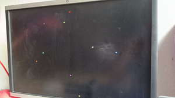
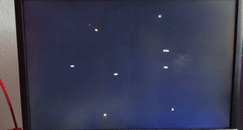

## Tang Nano 9K port

This is a Gowin Tang Nano 9K port of the project https://github.com/DigitalDesignDen/crude-3D-render-demo.git.
It uses the DVI/HDMI output for display.
It displays eight vertices of a hard-coded cube as colored points.
The renderer updates its projected
vertices once per video frame; it performs Y-axis rotation, uniform model
scaling, and perspective division. It intentionally has no line drawing or
frame buffer.


The default model scale is 0.5 (`MODEL_SCALE_Q8_8 = 128`, Q8.8) and the focal
length is 120 pixels. These are generics on `TOP` in `src/TOP.vhd`. The DVI
timing is 720x480 with the 27 MHz pixel clock and 5x serial PLL.

The original Cyclone V sources are found here: https://github.com/DigitalDesignDen/crude-3D-render-demo.git

## Original project


A deliberately crude and experimental, but functional 3D graphics pipeline written in VHDL. Fixed-point math, matrix transforms, perspective projection, and basic rendering experiments targeting FPGA hardware. Built for learning, tinkering, and iterative improvement. Not pretty, not fast, but real hardware 3D — and a playground for improvement.

## crude-3D-renderer-demo

> A minimal and intentionally crude 3D graphics pipeline implemented in VHDL and running on an FPGA.

<p align="center">
 
</p>


## Overview

This project is an experimental 3D renderer written entirely in **VHDL**, targeting low-cost FPGAs.
It implements a very simple graphics pipeline to explore what is *actually feasible* without CPUs,
GPUs, or softcores.

The focus is on **learning, experimentation, and clarity**, not performance or visual perfection.

---

## Features

* Fixed-point 3D math (no floating point)
* Model-view-projection pipeline
* Perspective projection
* ~~Wireframe rendering~~
* Rotation via transformation matrices
* ~~Rotation input via potentiometer + ADC an board OR rot input via counter~~
* HDMI / video output (FPGA-driven)

---

## Demo

|Rotating Cube|
|-|
||

---

## High-level pipeline

```text
3D Model (ROM)
   ↓
Matrix Transform
   ↓
Perspective Divide
   ↓
Screen Space Mapping
   ↓
Vertex coloring and thickening
   ↓
Video Output
```
---
## Project structure
./ <br>
 ├── _archive/               &nbsp;&emsp;&emsp;&emsp;&emsp;&emsp;# useful snippets and entities currently not used<br>
 ├── images/                 &nbsp;&emsp;&emsp;&emsp;&emsp;&emsp;# images for the README.md<br>
 ├── impl/                   &nbsp;&nbsp;&emsp;&emsp;&emsp;&emsp;&emsp;&emsp;# dir for config.json and output files of synth and pnr<br>
 ├── src/\*.vhd / \*.vhdl      &emsp;&emsp;# source files VHDL<br>
 ├── src/\*.sdc          &nbsp;&emsp;&emsp;&emsp;&emsp;&emsp;# Synopsys design contraint file (timing constraints)<br>
 ├── src/\*.cst               &nbsp;&emsp;&emsp;&emsp;&emsp;&emsp;# physical constraints file (pin mapping)<br>
 ├── *.gprj                  &nbsp;&emsp;&emsp;&emsp;&emsp;&emsp;&emsp;# gowin project file<br>
 └── *.vhd                  &nbsp;&emsp;&emsp;&emsp;&emsp;&emsp;&emsp;# VHDL source files

---
## Build / Simulation
* Target FPGA: GW1NR-9C on Tang Nano 9k
* Tested with Gowin V1.9.11.03 Education on Arch Linux in Ubuntu 22 Docker
* Tested only on Hardware
* No testbench coverage yet (wip)
---
## Compile Scripts

### synthesis & place & route
Build scripts depend very much on the type of toolchain and environment (docker/native) you are using.


### programming


---
### Limitations
* No Z-buffer
* Timing not met -> seems to be working but the occasional flicker of a vertex can be observed
* No filled faces / triangles
* No clipping
* Sometimes precision artifacts due to fixed-point math
* ~~Choppy motion when depth changes (known issue)~~ *fixed*
* No frame buffer
* ~~Line positions are computed in real time for each pixel with vector math -> low vertex count models only~~
---
### Roadmap / Ideas
* [ ] more More pipelining to meet timing
* [ ] Line clipping
* [ ] Simple triangle fill
* [ ] Depth sorting
* [ ] Better fixed-point scaling strategy
* [ ] More control interfaces
* [ ] Frame buffer
* [ ] Line-drawing algorithm like Bresenham or Xiaolin Wu
